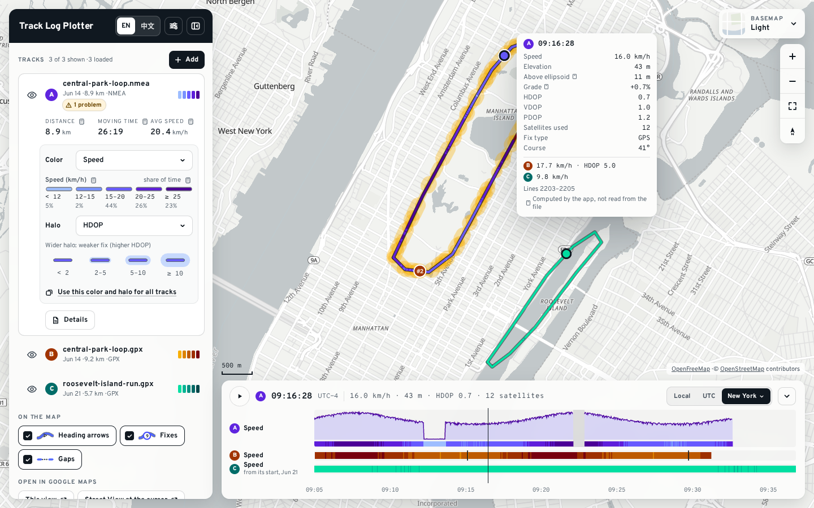

# Track Log Plotter

[简体中文](README.zh-CN.md)

Plot GPS track logs on a map, in your browser. Open GPX, NMEA and Columbus Fusion files from your computer and see them on a zoomable map, colored by speed, elevation, grade, HDOP, satellites used, fix type or acceleration, with a second measure shown as a halo around the line.

**Use it:** https://ricebucket.github.io/track-log-plotter/



## What it does

- **Several tracks.** Up to ten loaded and three shown at once. One track on its own gets broad multi-hue colors; with several, each track has its own color range so they stay apart.
- **Color and halo.** Pick a measure for each, per track. The halo widens toward the far end of its measure, so two measures read at once.
- **Timeline.** One lane per shown track and a shared cursor; the selected track's lane is a graph filled with its map colors. The cursor snaps to the nearest fix; scroll or drag across the timeline to zoom in, and Reset zoom zooms back out. Drag along a track on the map to move the cursor there too, or press play to replay the tracks in a loop (gaps are skipped). Tracks recorded at the same time line up by clock (two loggers carried together); a track recorded at another time lines up at its start. Logs that run past midnight or over several days show their dates.
- **Fix inspector.** The cursor shows every value at that moment: position (latitude and longitude), speed, elevation, height above the ellipsoid, grade, HDOP, VDOP, PDOP, satellites used, fix type, course, button presses and the line in the file.
- **Computed values are marked.** Anything the app works out itself, such as grade, distance or speed from positions, carries a calculator icon that explains how.
- **Damaged logs still load.** A cut-off last line, bad checksums, sentences glued together, stray bytes, time running backwards or impossible jumps are skipped and listed on the track's properties page.
- **Keyless basemaps.** OpenStreetMap, OpenFreeMap Light and Dark, OpenTopoMap and Esri World Imagery (satellite and hybrid), with links that open the same spot in Google Maps, and Street View at the selected point.
- **Motion data.** Columbus Fusion logs recorded with the motion sensor on add an Acceleration measure: the strongest accelerometer reading in each second, gravity included (about 1 g at rest).
- **Time zones.** Local time, UTC or any zone. A file whose times have no zone, such as a Columbus Fusion log, is read as UTC until you set the zone it was recorded in, on its properties page.
- **English and 简体中文**, switched in the Options menu (top right), on desktops and phones. English shows 12-hour times, Chinese 24-hour.

Supports GPX (tracks, and routes that have times), NMEA and Columbus Fusion (CSV).

## Privacy

Your track files never leave your computer: they are read in your browser and never uploaded. To draw the map, your browser requests:

- map tiles from the basemap you pick (that provider sees which area you view), and
- the Overpass fonts from Google Fonts (Google receives your IP address and browser details).

Your settings (language, basemap, units, time zone) are saved in your browser. There are no analytics and no cookies.

## Basemaps and attribution

| Basemap | Provider |
| --- | --- |
| OpenStreetMap | © OpenStreetMap contributors |
| Light, Dark | OpenFreeMap, © OpenStreetMap contributors |
| Topographic | © OpenTopoMap (CC-BY-SA), © OpenStreetMap contributors, SRTM |
| Satellite, Hybrid | Esri World Imagery: Esri, Maxar, Earthstar Geographics and the GIS User Community |

The app shows each provider's attribution on the map.

## Development

To run it on your computer, with Node.js 20 or newer:

```sh
npm install
npm run dev
```

[DEVELOPMENT.md](DEVELOPMENT.md) covers setup, commands, tests, deployment and the checks to run before every push.

## License

GPL-3.0. See [LICENSE](LICENSE).
