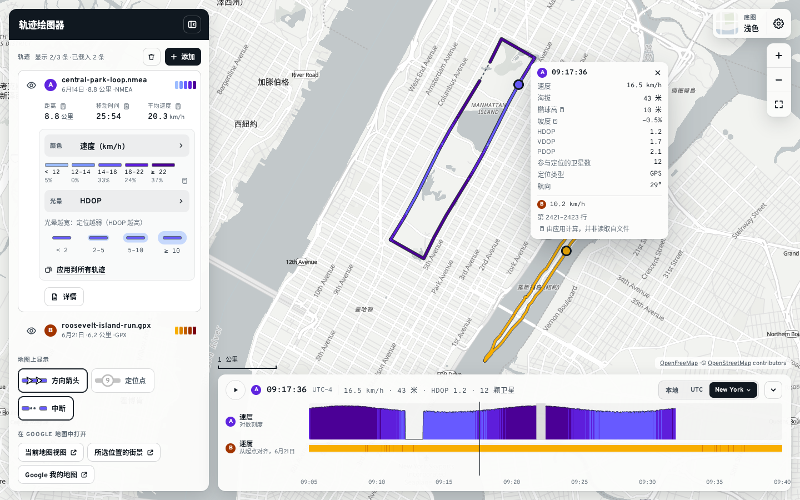

# 轨迹绘图器（Track Log Plotter）

[English](README.md)

在浏览器中把 GPS 轨迹记录画在地图上。打开电脑上的 GPX、NMEA 和 Columbus Fusion 文件，即可在可缩放的地图上查看，并按速度、海拔、坡度、HDOP、参与定位的卫星数、定位类型或加速度着色，同时用线条周围的光晕显示第二项数据。

**在线使用：** https://ricebucket.github.io/track-log-plotter/



## 功能

- **多条轨迹。** 最多载入 10 条，同时显示 3 条。只显示一条时使用多色渐变；显示多条时，每条轨迹各有一个色系，便于区分。
- **颜色与光晕。** 每条轨迹都可以分别选择颜色和光晕所表示的数据。光晕越接近数据的另一端越宽，一眼可以看出两项数据。
- **时间轴。** 每条显示的轨迹一条通道，共用一个光标；所选轨迹的通道是一张用地图颜色填充的曲线图。光标会对齐到最近的定位点；在时间轴上拖动可放大，“显示全部”可恢复。也可以在地图上沿轨迹拖动来移动光标，或按播放键循环回放（会跳过中断）。同时记录的轨迹按时钟对齐（例如一起携带的两个记录器）；其他时间记录的轨迹按起点对齐。跨过午夜或持续多天的记录会显示日期。
- **定位点检查。** 光标处显示该时刻的所有数值：速度、海拔、椭球高、坡度、HDOP、VDOP、PDOP、参与定位的卫星数、定位类型、航向、按键标记以及在文件中的行号。
- **计算值都有标注。** 应用自己计算出的数值（例如坡度、距离或根据位置推算的速度）旁边都有计算器图标，说明是怎样计算的。
- **损坏的记录也能载入。** 最后一行被截断、校验和不符、语句粘连、杂乱字节、时间倒退或不可能的跳变都会被跳过，并在轨迹属性页中列出。
- **无需密钥的底图。** OpenStreetMap、OpenFreeMap 浅色与深色、OpenTopoMap 以及 Esri 卫星影像（影像与影像 + 地名），并可在 Google 地图中打开同一位置，或查看所选位置的街景。
- **运动数据。** 开启运动传感器记录的 Columbus Fusion 文件会多出“加速度”一项：每秒内最强的加速或颠簸，已去除重力。
- **时区。** 本地时间、UTC 或任意时区。时间不带时区的文件（例如 Columbus Fusion 记录）先按 UTC 读取，可以在属性页中设定记录时所在的时区。
- **English 和简体中文**，在右上角的“选项”菜单中切换，电脑和手机都适用。英文界面使用 12 小时制，中文界面使用 24 小时制。

支持 GPX（轨迹，以及带时间的路线）、NMEA 和 Columbus Fusion（CSV）。

## 隐私

轨迹文件不会离开你的电脑：文件在浏览器中读取，不会上传。为了绘制地图，浏览器会请求：

- 你所选底图的地图瓦片（该服务商能看到你查看的区域），以及
- 来自 Google Fonts 的 Overpass 字体（Google 会收到你的 IP 地址和浏览器信息）。

你的设置（语言、底图、单位、时区）保存在浏览器中。没有统计分析，也不使用 Cookie。

## 底图与署名

| 底图 | 提供方 |
| --- | --- |
| OpenStreetMap | © OpenStreetMap 贡献者 |
| 浅色、深色 | OpenFreeMap，© OpenStreetMap 贡献者 |
| 地形 | © OpenTopoMap（CC-BY-SA），© OpenStreetMap 贡献者，SRTM |
| 卫星影像、影像 + 地名 | Esri World Imagery：Esri、Maxar、Earthstar Geographics 及 GIS 用户社区 |

应用会在地图上显示各提供方的署名。

## 开发

在自己的电脑上运行（需要 Node.js 20 或更新版本）：

```sh
npm install
npm run dev
```

准备工作、命令、测试、部署以及每次推送前需要运行的检查，请见 [DEVELOPMENT.zh-CN.md](DEVELOPMENT.zh-CN.md)。

## 许可证

GPL-3.0，详见 [LICENSE](LICENSE)。
